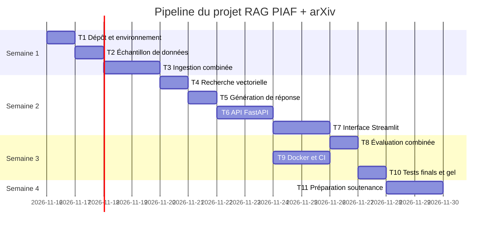

# Dossier de lancement (semaine 1)

Nov 9, 2026 · @Larhlimi

## Mode d'emploi

La semaine 1 est décisive : sur un projet de 4 semaines, un cadrage flou ou des données indisponibles ne se rattrapent pas. Ce dossier permet à l'enseignant de valider, faire reprendre ou refuser le projet sous 48 heures.

Le dossier comporte quatre livrables. **L'équipe se les répartit : chaque membre rédige seul le ou les livrables dont il est responsable, puis un autre membre le relit.** Le nom du rédacteur et du relecteur figure en tête de chaque livrable ; c'est une preuve de contribution pour la note individuelle.

**Répartition selon la taille de l'équipe**

| Taille | Membre A | Membre B | Membre C | Membre D |
| --- | --- | --- | --- | --- |
| 2 étudiants | 1. Descriptif + 3. Maquette | 2. Dataset + 4. Pipeline |  |  |
| 3 étudiants | 1. Descriptif + 4. Pipeline (consolidation) | 2. Dataset | 3. Maquette |  |
| 4 étudiants | 1. Descriptif | 2. Dataset | 3. Maquette | 4. Pipeline (consolidation) |

Le pipeline des tâches (livrable 4) est consolidé par un seul membre, mais **chaque membre y ajoute lui-même ses propres tâches**.

**Notre répartition** (équipe de 2 : binôme Othmane Amaadour & Mohcine ERRACHID)

| Livrable | Rédacteur | Relecteur | Fichier dans le dépôt |
| --- | --- | --- | --- |
| 1. Descriptif du projet | Othmane Amaadour | Mohcine ERRACHID | `docs/semaine1/1-descriptif.md` |
| 2. Dataset | Mohcine ERRACHID | Othmane Amaadour | `docs/semaine1/2-dataset.md` + `data/sample/` |
| 3. Maquette globale | Othmane Amaadour | Mohcine ERRACHID | `docs/semaine1/3-maquette.md` + `docs/semaine1/img/` |
| 4. Pipeline des tâches | Mohcine ERRACHID | Othmane Amaadour | `docs/semaine1/4-pipeline.md` |

**Circuit GitHub**

1. Le coordinateur crée le dossier `docs/semaine1/` avec un `README.md` qui reprend le tableau « Notre répartition ».
2. Chaque rédacteur copie la section de son livrable dans le fichier indiqué, travaille sur sa propre branche (`semaine1/dataset`, par exemple) et ouvre une pull request.
3. Le relecteur vérifie les critères d'acceptation du livrable, commente dans la pull request, puis l'approuve.
4. Une pull request n'est fusionnée qu'après approbation. Les quatre livrables sont fusionnés sur la branche principale avant la date limite.
5. Le coordinateur pose l'étiquette `semaine1-remis` sur le dernier commit et en informe l'enseignant.

Remplacez chaque `[à compléter]` par vos réponses. Les exemples en italique viennent du projet n° 1 du catalogue (agent de recherche documentaire) ; supprimez-les dans votre version. Le dossier rempli tient sur 4 à 6 pages, maquettes comprises.

## Livrable 1 : descriptif du projet mis à jour

Rédacteur : Othmane Amaadour   Relecteur : Mohcine ERRACHID   Fichier : `docs/semaine1/1-descriptif.md`

Le descriptif adapte la fiche du catalogue à votre version du projet. Il doit pouvoir être lu seul par quelqu'un qui ne connaît pas le catalogue.

**1.1 Contexte et problème** (5 lignes au plus) : quel problème métier, pour qui, comment on fait aujourd'hui sans l'agent.

Les étudiants et chercheurs doivent chercher manuellement des informations dans des articles encyclopédiques (Wikipédia en français) et des papiers scientifiques (arXiv, en anglais). Aujourd'hui, ils effectuent des recherches par mots-clés sans garantie de pertinence sémantique, sans citations automatiques des sources, et sans mécanisme permettant de refuser de répondre quand l'information est absente du corpus. Cela entraîne du temps perdu et des réponses approximatives ou hallucinées.

**1.2 Objectif** en une phrase :

Construire un agent de recherche documentaire (RAG) bilingue français/anglais qui répond aux questions en s'appuyant uniquement sur un corpus indexé (Wikipédia PIAF + papiers arXiv), avec citations de sources et refus déterministe hors corpus.

**1.3 Utilisateurs cibles et scénario d'usage principal** : qui utilise l'agent et ce qu'il fait, étape par étape.

Utilisateurs : étudiants et enseignants-chercheurs du cours "Développement et déploiement d'applications intelligentes".

Scénario principal :
1. L'utilisateur ouvre l'interface Streamlit (3 onglets : question, corpus, évaluation).
2. Il saisit une question en français ou en anglais dans l'onglet "Poser une question".
3. Il clique sur "Lancer la recherche" ; l'API FastAPI interroge ChromaDB (recherche vectorielle, seuil de distance cosinus 0.19, filtre par dataset PIAF ou arXiv).
4. L'agent génère une réponse citée au format [source, page] via le LLM Groq (gpt-oss-120b), ou refuse si aucun passage ne dépasse le seuil de similarité.
5. L'utilisateur consulte les sources citées et, si besoin, les métriques (Recall@3, MRR@10, taux de refus) dans l'onglet évaluation.

**1.4 Fonctionnalités du MVP** (2 à 3 pour un binôme)

| N° | Fonctionnalité | Ce que l'utilisateur voit ou obtient | Priorité (indispensable, souhaitable) |
| --- | --- | --- | --- |
| F1 | Ingestion et indexation des documents | Lancement de l'ingestion qui charge PIAF et arXiv, crée les embeddings et les stocke dans ChromaDB | Indispensable |
| F2 | Recherche et réponse citée | Pose d'une question, obtention d'une réponse avec sources et numéros de page | Indispensable |
| F3 | Refus déterministe hors corpus | Quand aucun passage ne dépasse le seuil de similarité, l'agent refuse de répondre explicitement | Indispensable |

**1.5 Services et composants techniques**

| Service ou composant | Rôle dans le projet | Technologie choisie | Pourquoi ce choix |
| --- | --- | --- | --- |
| Modèle (LLM ou ML) | Génération de réponses et calcul des embeddings | intfloat/multilingual-e5-small (embeddings) + Groq openai/gpt-oss-120b (LLM) | Embedding multilingue FR/EN performant, LLM puissant via API gratuite |
| Recherche ou mémoire (RAG, base vectorielle, SGBD) | Recherche des passages les plus proches et stockage persistant | ChromaDB (espace cosine) | Base vectorielle légère, persistante, seuil de distance configurable |
| Outils appelés par l'agent | Recherche des passages pertinents avec filtrage par dataset | `src/query.py` (fonction `chercher` avec seuil + paramètre `dataset`) | Évite la dilution inter-langues (FR/EN) en filtrant PIAF ou arXiv |
| API | Exposition des endpoints `/search` et `/ask` | FastAPI | Rapide, documentation automatique (`/docs`), facile à tester |
| Interface | Interface utilisateur avec 3 onglets | Streamlit | Déploiement rapide, affichage des métriques et des sources citées |
| Conteneur et intégration continue | Packaging reproductible et tests automatisés | Docker, GitHub Actions | Garantit que l'environnement fonctionne sur n'importe quelle machine |

**1.6 Hors périmètre** (ce que vous ne ferez pas) :

Documents scannés sans OCR, gestion des droits d'accès utilisateurs, recherche multimédia (images, vidéo), historique de conversation, authentification, fine-tuning du modèle d'embedding.

**1.7 Écart avec la fiche du catalogue** : ce que vous ajoutez, retirez ou modifiez, et pourquoi.

Ajout du dataset arXiv (5 papiers scientifiques en anglais : Attention, BERT, RAG, LoRA, ResNet) en complément de PIAF (Wikipédia en français). Seuil de distance cosinus calibré à 0.19 sur multilingual-e5-small. Architecture dual-dataset avec filtre par dataset dans la recherche pour éviter la dilution des résultats entre les deux langues.

**Critères d'acceptation (vérifiés par le relecteur)**

- [x] Le problème et l'utilisateur sont compréhensibles sans le catalogue.
- [x] Le nombre de fonctionnalités correspond à la taille de l'équipe (3 pour un binôme).
- [x] Chaque fonctionnalité est démontrable (pas de formulation vague comme « améliorer »).
- [x] Chaque composant technique a une justification d'une ligne.
- [x] Le hors périmètre est rempli.

## Livrable 2 : dataset

Rédacteur : Mohcine ERRACHID   Relecteur : Othmane Amaadour   Fichiers : `docs/semaine1/2-dataset.md` + `data/sample/`

Sans données utilisables dès la semaine 1, le projet ne peut pas tenir en 4 semaines. **Un échantillon réel doit déjà être dans le dépôt** (quelques fichiers ou une centaine de lignes, moins de 10 Mo). Les données complètes volumineuses ne vont pas dans Git : indiquez où elles se trouvent.

**2.1 Description**

| Rubrique | Réponse |
| --- | --- |
| Nom et source (lien) | PIAF (French Questions & Answers) — dataset Wikipédia français Q&A, disponible sur Kaggle / Etalab | arXiv — 5 papiers fondateurs en informatique (Attention Is All You Need, BERT, RAG, LoRA, ResNet) en PDF et texte |
| Producteur ou propriétaire | Etalab / Ministère français (licence CC0) | arXiv (Cornell University), papiers en libre accès |
| Volume (nombre de fichiers, lignes, pages, taille) | PIAF : 3 835 lignes, 761 paragraphes uniques, 191 sujets Wikipédia | arXiv : 5 PDFs (~6 Mo total), 5 articles texte, ~88 pages, 374 passages après chunking |
| Format et structure | CSV (colonnes : id, title, context, question, answers) | PDF et TXT, découpés en chunks de 1024 caractères avec 100 de chevauchement |
| Langue et période | Français (Wikipédia) | Anglais (2017-2021) |
| Licence et droits d'usage | CC0 (domaine public) | arXiv (usage recherche et éducation autorisé) |
| Données personnelles ou sensibles, et traitement prévu | Aucune donnée personnelle | Aucune donnée personnelle |
| Emplacement des données complètes | `data/train.csv` (extrait de `archive.zip`) | `data/pdfs/` et `data/articles/` |

**2.2 Qualité constatée sur l'échantillon** : valeurs manquantes, doublons, bruit, documents illisibles, déséquilibre.

- `train.csv` contient des balises HTML dans les titres (`<i>`, `<span>`, `<abbr>`) : nettoyées à l'ingestion par `nettoyer_html()`.
- Le champ `answers` contient des guillemets et des virgules : géré par `csv.DictReader` (pas pandas, qui plantait avec une `ParserError`).
- 761 paragraphes uniques après déduplication par contexte (sur 3 835 lignes).
- Les PDFs arXiv génèrent des avertissements `fontTools` non bloquants ; le texte est extrait correctement.
- Aucun doublon significatif après nettoyage ; aucun document illisible détecté.

**2.3 Justification** : pour chaque fonctionnalité du livrable 1, expliquez en une ligne en quoi ces données permettent de la réaliser.

| Fonctionnalité | Données utilisées | En quoi elles suffisent |
| --- | --- | --- |
| F1 | `data/train.csv` + `data/pdfs/` + `data/articles/` | 761 paragraphes FR + 374 passages EN, suffisants pour indexer et tester l'ingestion |
| F2 | Même corpus (PIAF + arXiv) | Questions en français et en anglais couvertes par `multilingual-e5-small` (384 dimensions, bilingue) |
| F3 | `data/questions_hors_corpus.csv` | 30 questions hors sujet pour mesurer le taux de refus et valider le mécanisme de refus |

**2.4 Alternative de repli** : si la source principale devient inaccessible ou se révèle inutilisable, quelle autre source (jeu public, données simulées ou générées) et ce que vous perdez en l'utilisant.

Alternative : Wikipedia API en français (quelques centaines d'articles sélectionnés manuellement). Perte : la structure Q&A prête à l'emploi de PIAF et les 5 papiers scientifiques ciblés d'arXiv. Le jeu de test devrait être regénéré manuellement.

**2.5 Jeu de test** : comment vous mesurerez la qualité de l'agent. Taille (au moins 20 cas), origine, réponses attendues rédigées par qui.

- PIAF : 3 835 questions issues de `data/train.csv`, réponse attendue = titre du paragraphe (nettoyé).
- arXiv : 15 questions issues de `data/questions_reference.csv`, réponse attendue = nom du fichier source.
- Hors corpus : 30 questions issues de `data/questions_hors_corpus.csv`, réponse attendue = refus.
- Total : 3 880 cas de test. Réponses attendues extraites automatiquement des fichiers sources (pas de saisie manuelle).
- Métriques : Recall@1, Recall@3 (objectif ≥ 80%), MRR@10, taux de refus hors corpus.

**Critères d'acceptation (vérifiés par le relecteur)**

- [x] L'échantillon est dans `data/sample/` et s'ouvre sans erreur.
- [x] La licence autorise l'usage dans un projet de cours (CC0 pour PIAF, arXiv en libre accès).
- [x] Aucune donnée personnelle n'est présente.
- [x] Chaque fonctionnalité du MVP est couverte par la justification.
- [x] L'alternative de repli est réellement accessible (Wikipedia API).
- [x] Le jeu de test est défini (3 880 cas, réponses attendues extraites des sources).

## Livrable 3 : maquette globale

Rédacteur : Othmane Amaadour   Relecteur : Mohcine ERRACHID   Fichiers : `docs/semaine1/3-maquette.md` + `docs/semaine1/img/`

La maquette comporte deux vues : l'architecture (comment le système fonctionne) et les écrans (ce que voit l'utilisateur).

**3.1 Schéma d'architecture.**

```mermaid
flowchart LR
    U[Utilisateur] --> UI[Interface Streamlit<br/>3 onglets : question / corpus / évaluation]
    UI -->|question| API[API FastAPI<br/>GET /search, POST /ask]
    API --> R[Recherche vectorielle<br/>src/query.py : chercher()]
    R -->|filtre dataset| DB[(ChromaDB<br/>cosine distance, seuil 0.19)]
    ING[Ingestion<br/>src/ingest_combined.py] -->|PIAF + arXiv| DB
    R -->|passages| LLM[LLM Groq<br/>gpt-oss-120b]
    LLM -->|réponse + citations [source, page]| API
    API --> UI
    EVAL[Évaluation<br/>src/evaluate_combined.py] -->|métriques| UI
```

**3.2 Légende du schéma** : une ligne par composant, avec la fonctionnalité (F1, F2...) qu'il sert.

| Composant | Fonctionnalité |
| --- | --- |
| Utilisateur | Déclenche la requête (F2, F3) |
| Interface Streamlit | Affiche la question, les sources, les métriques (F2, F3) |
| API FastAPI | Endpoints `/search` et `/ask` (F2) |
| Recherche vectorielle | `chercher()` avec seuil 0.19 et filtre par dataset (F2) |
| ChromaDB | Stockage des embeddings PIAF + arXiv (F1) |
| Ingestion | Indexation des deux datasets (F1) |
| LLM Groq | Génération de la réponse citée (F2) |
| Évaluation | Recall@3, MRR@10, taux de refus (F3) |

**3.3 Maquette des écrans.** 2 à 4 écrans principaux.

| Écran | Image (`img/...`) | Fonctionnalités affichées | Action principale de l'utilisateur |
| --- | --- | --- | --- |
| Écran d'accueil / question | `img/ecran-question.png` | Zone de saisie, slider top-k, seuil de distance, bouton "Lancer la recherche" (F2) | Saisir une question et lancer la recherche |
| Écran de réponse | `img/ecran-reponse.png` | Réponse générée, sources citées `[source, page]`, extraits consultés avec distances, message de refus si applicable (F2, F3) | Lire la réponse et vérifier les sources |
| Écran corpus | `img/ecran-corpus.png` | Liste des paragraphes PIAF indexés, documents arXiv, nombre total par dataset (F1) | Consulter le contenu indexé |
| Écran évaluation | `img/ecran-evaluation.png` | Métriques Recall@1, Recall@3, MRR@10, taux de refus, seuil (F3) | Vérifier que les objectifs sont atteints |

**3.4 Parcours utilisateur** : enchaînement des écrans pour le scénario principal du livrable 1.

Écran d'accueil (question) → saisie de la question → clic sur "Lancer la recherche" → Écran de réponse (avec sources ou refus) → optionnel : Écran corpus pour vérifier l'indexation → optionnel : Écran évaluation pour consulter les métriques.

**Critères d'acceptation (vérifiés par le relecteur)**

- [x] Chaque composant du livrable 1 apparaît dans le schéma, et inversement.
- [x] Le parcours d'une requête se suit de bout en bout sur le schéma.
- [x] Chaque fonctionnalité du MVP est visible sur au moins un écran.
- [x] Le schéma s'affiche correctement sur GitHub (Mermaid valide).

## Livrable 4 : pipeline des tâches prévues

Consolidateur : Mohcine ERRACHID   Relecteur : Othmane Amaadour   Fichier : `docs/semaine1/4-pipeline.md`

Le pipeline découpe le projet en tâches de 1 à 2 jours. **Chaque membre saisit lui-même ses tâches** ; le consolidateur vérifie les dépendances et l'équilibre de la charge. Les tâches sont aussi créées comme issues GitHub (ou dans un tableau GitHub Projects) pour être suivies dans le rapport hebdomadaire.

**4.1 Liste des tâches**

| ID | Tâche | Fonctionnalité | Responsable | Dépend de | Semaine | Terminée quand ? (critère vérifiable) |
| --- | --- | --- | --- | --- | --- | --- |
| T1 | Créer le dépôt GitHub, l'arborescence et le fichier `.env` | — | Othmane Amaadour | — | 1 | Dépôt accessible, `python src/query.py` ne plante pas |
| T2 | Préparer l'échantillon de données dans `data/sample/` (PIAF + arXiv) | F1 | Mohcine ERRACHID | T1 | 1 | `data/sample/` contient au moins 10 fichiers lisibles |
| T3 | Implémenter l'ingestion combinée PIAF + arXiv (`src/ingest_combined.py`) | F1 | Mohcine ERRACHID | T2 | 1 | `python src/ingest_combined.py` indexe > 1000 passages |
| T4 | Implémenter la recherche vectorielle avec seuil et filtre dataset | F2 | Othmane Amaadour | T3 | 2 | `chercher()` retourne des passages sous le seuil 0.19 |
| T5 | Implémenter la génération de réponse citée avec Groq | F2 | Othmane Amaadour | T4 | 2 | `repondre()` retourne une réponse avec `[source, page]` |
| T6 | Développer l'API FastAPI (`/search`, `/ask`, `/sources`) | F2 | Othmane Amaadour | T5 | 2 | `uvicorn app.main:app` répond sur `http://127.0.0.1:8000` |
| T7 | Développer l'interface Streamlit (3 onglets) | F2, F3 | Mohcine ERRACHID | T6 | 2 | `streamlit run ui/app_streamlit.py` affiche les 3 onglets |
| T8 | Implémenter l'évaluation combinée (Recall@3, MRR@10, refus) | F3 | Mohcine ERRACHID | T7 | 3 | `python src/evaluate_combined.py` affiche Recall@3 ≥ 80% |
| T9 | Dockeriser l'application et configurer GitHub Actions | — | Othmane Amaadour | T6 | 3 | `docker build` réussit, tests CI au vert |
| T10 | Tests finals, correction des bugs, gel du code | — | Mohcine ERRACHID | T8, T9 | 3 | Tous les tests passent, Recall@3 stable ≥ 80% |
| T11 | Préparer la soutenance (démo + diaporama) | — | Othmane Amaadour | T10 | 4 | Démo fonctionnelle en direct |

**4.2 Jalons hebdomadaires** (repris de la fiche de cadrage)

| Semaine | Jalon démontrable | Tâches qui y mènent |
| --- | --- | --- |
| 1 | Dossier de lancement fusionné, prototype en script | T1, T2, T3 |
| 2 | Agent exposé par l'API, premiers tests | T4, T5, T6, T7 |
| 3 | MVP complet, Docker et CI au vert | T8, T9 |
| 4 | Résultats mesurés, code gelé, soutenance | T10, T11 |

**4.3 Vue chronologique.** Diagramme de Gantt en Mermaid :



**4.4 Chemin critique et charge**

- Chaîne de tâches dont le moindre retard décale la soutenance : T1, T2, T3, T4, T5, T6, T7, T8, T10.
- Charge par membre (nombre de jours de tâches) :
  - Othmane Amaadour : T1 (1) + T4 (1) + T5 (1) + T6 (2) + T9 (2) + T11 (2) = 9 jours
  - Mohcine ERRACHID : T2 (1) + T3 (2) + T7 (2) + T8 (1) + T10 (1) = 7 jours
- Écart de charge : 2 jours (acceptable, inférieur au seuil de 2 jours).

**Critères d'acceptation (vérifiés par le relecteur)**

- [x] Aucune tâche ne dépasse 2 jours.
- [x] Chaque fonctionnalité du MVP a au moins une tâche, et chaque tâche a un critère de fin vérifiable.
- [x] Le MVP est complet au plus tard en fin de semaine 3 (T8, T9, T10 terminés en semaine 3).
- [x] Chaque membre a saisi ses propres tâches ; l'écart de charge entre membres reste inférieur à 2 jours (9 vs 7 jours).
- [x] Les tâches existent comme issues GitHub (à créer après fusion du livrable).

## Remise et décision de l'enseignant

**Checklist de remise (coordinateur)**

- [ ] `docs/semaine1/README.md` avec la répartition rédacteurs et relecteurs
- [ ] Les quatre livrables fusionnés sur la branche principale, chacun par une pull request approuvée par son relecteur
- [ ] Échantillon de données dans `data/sample/`
- [ ] Schéma et écrans visibles sur GitHub
- [ ] Issues GitHub créées pour les tâches du pipeline
- [ ] Étiquette `semaine1-remis` posée et enseignant prévenu

**Décision de l'enseignant (sous 48 heures)**

| Critère | Type | Respecté | Commentaire |
| --- | --- | --- | --- |
| Données accessibles et échantillon présent (L2) | Bloquant | ☐ |  |
| MVP réaliste en 4 semaines pour cette taille d'équipe (L1, L4) | Bloquant | ☐ |  |
| Livrables répartis, chacun avec un rédacteur et un relecteur distincts | Bloquant | ☐ |  |
| Licence et données personnelles traitées (L2) | Bloquant | ☐ |  |
| Architecture cohérente avec les fonctionnalités (L1, L3) | À améliorer | ☐ |  |
| Écrans couvrant tout le MVP (L3) | À améliorer | ☐ |  |
| Tâches courtes, critères de fin vérifiables, charge équilibrée (L4) | À améliorer | ☐ |  |
| Alternative de repli et jeu de test définis (L2) | À améliorer | ☐ |  |

**Décision** : ☐ Validé   ☐ À reprendre   ☐ Refusé (changement de sujet)

Date et visa : \_\_\_\_\_\_\_\_\_\_\_\_\_\_\_\_\_\_\_\_

**Lien avec l'évaluation.** Ce dossier sert de référence pour le critère P1 (respect du cadrage) et alimente P3 (jeu de test et indicateurs) et P7 (pipeline et suivi). La répartition et les pull requests de chaque membre comptent comme preuves pour le coefficient individuel.
